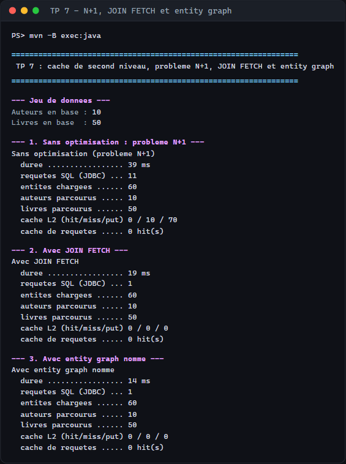
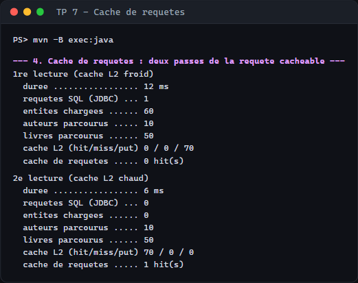
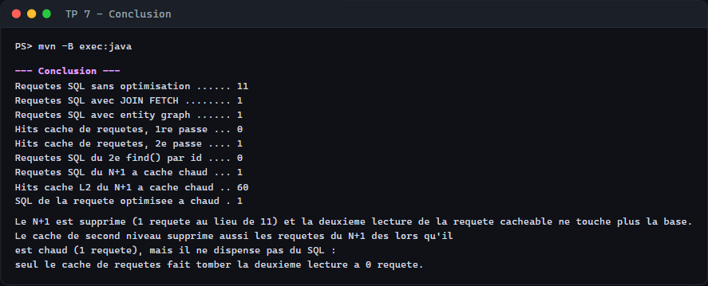
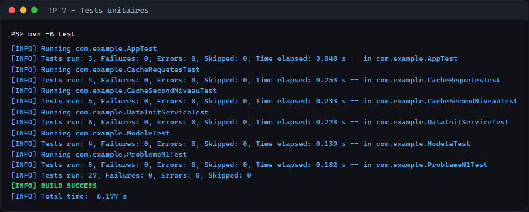

# TP 7 : Activation du cache de second niveau, optimisation des performances et suppression du problème N+1 avec JOIN FETCH et Entity Graph

## Exécution du projet : N+1, JOIN FETCH et entity graph

## Cache de requêtes

## Conclusion

## Tests unitaires (27 tests, 0 échec)
